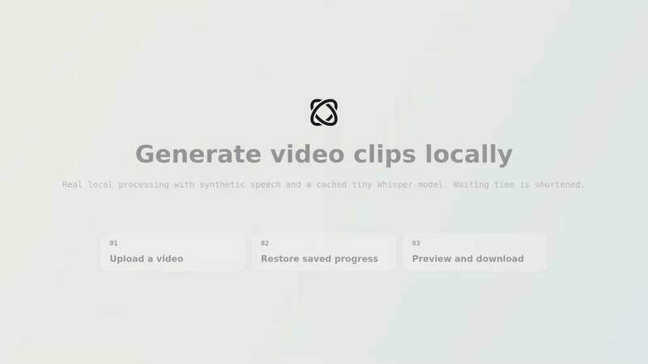

# Local Video Clip Generator (MVP)

Turn speech in a video into up to three vertical clips. Transcription runs on your
CPU with [faster-whisper](https://github.com/SYSTRAN/faster-whisper); highlight
selection uses deterministic rules, and FFmpeg creates the clips.

**No OpenAI API key, API tokens, credits, or paid inference service is required.**
Your audio stays on the machine running the backend. The first run downloads a
public Whisper model from Hugging Face; subsequent runs reuse its local cache.

## Walkthrough

[](docs/walkthrough.mp4)

[Watch or download the walkthrough (MP4)](docs/walkthrough.mp4).

This silent recording shows a real local run: upload a video, follow its job
status, reopen the saved result, preview a generated clip, and download it.
It uses synthetic speech and a cached `tiny` Whisper model. Waiting time is
shortened; processing speed varies with your hardware.

## Quickstart with Docker

```bash
git clone https://github.com/droidjedininja/ai-video-clip-generator.git
cd ai-video-clip-generator
docker compose up --build
```

Open http://localhost:3000. The backend is at http://localhost:8000. No `.env` is
required. Docker installs FFmpeg/ffprobe and CPU inference dependencies. A named
Docker volume preserves downloaded models across container restarts/rebuilds.

The default `tiny` model prioritizes modest CPU and memory use. Its first download
is roughly 75 MiB, plus tokenizer files; dependency/image downloads are larger.
Reserve at least 2 GiB free RAM for the default setup plus disk for models/videos.
Processing speed depends on hardware. Larger models consume more RAM and take
longer, so start with `tiny` and a short video with clear speech.

## Optional settings

Copy `.env.example` to `.env` only if you want to override defaults:

| Variable | Default | Purpose |
| --- | --- | --- |
| `WHISPER_MODEL` | `tiny` | `tiny`, `base`, or `small`; larger models may improve accuracy |
| `WHISPER_TIMEOUT_SECONDS` | `600` | Worker wall-clock timeout, including model loading/download; 1–3600 |
| `MAX_QUEUED_JOBS` | `5` | Waiting uploads in addition to one active job; 1–20 |
| `JOB_RETENTION_HOURS` | `24` | Expire standalone uploads and completed clips after this many hours; positive and at most 8760 |
| `JOB_CLEANUP_INTERVAL_SECONDS` | `300` | Sweep interval; 1–86400 seconds. Cleanup also runs at startup |
| `WHISPER_OFFLINE` | `0` | Set to `1` after the selected model is cached to prohibit model downloads |
| `WHISPER_CACHE_DIR` | `/models` in Docker | Native model directory; default `~/.cache/video-clip-whisper`. Docker uses its `/models` volume |

For example, `WHISPER_MODEL=base docker compose up --build` selects the base model.
Restart the backend after changing settings. Download each selected model once
before enabling offline mode. Runtime transcription uses CPU int8 and two CPU
threads, with one pipeline at a time per backend process. No GPU is required.

## How highlights are selected

Whisper supplies text and segment timestamps. The selector builds speech windows
up to 45 seconds long, ranks them by speech density and simple question/explanation
cues, and returns at most three nonoverlapping windows in chronological order.
Final timestamps are constrained to the video duration. It does not call an LLM
or infer visual excitement, emotion, virality, or the best camera framing. Results
need human review; tiny-model transcription errors and non-English cue words can
reduce selection quality. Silent videos return an error instead of invented clips.

## Limits and storage

- Containers: MP4, MOV, MKV, WebM, M4V and AVI, with an audio track.
- Maximum saved video size: 100 MiB; duration must be positive and at most one hour.
- Total request bodies are limited to 101 MiB, including multipart overhead. Oversized
  Content-Length values are rejected immediately. Streamed/chunked bodies are counted
  before multipart parsing, so omitting or understating Content-Length cannot bypass
  the cap. At most two upload/write requests are admitted per backend process.
- Bodies are staged in bounded temporary files before parsing and replayed only after
  passing the limit. Staging files close on rejection, disconnect, success or failure.
- Audio is extracted to mono MP3 locally. There is no hosted transcription size cap.
- UUID-based job directories isolate uploads and output clips; original filenames
  never become disk paths. Unsafe names and unsupported extensions are rejected.
- Uploads return a job ID after saving and queueing, without waiting for transcription
  or rendering. One local worker processes jobs, with at most five waiting by default.
  A full queue returns HTTP 429; upload/write concurrency limits also remain in place.
- ffprobe, extraction and each clip render have 15, 120 and 180 second timeouts.
  Local transcription runs in a subprocess with the configurable timeout above.
  A one-hour upload may exceed that budget on slower CPUs.
- Source video and extracted audio are removed after success. Failed jobs retain
  their status/error but remove source, audio and partial clips. Completed/failed
  jobs and standalone uploads expire according to `JOB_RETENTION_HOURS` (24 hours
  by default). Models remain in their separate cache.

## Automatic cleanup

Retention starts when a standalone upload or processing job finishes. Queued and
active jobs are excluded from expiry while waiting/processing. Cleanup runs at server
startup and every `JOB_CLEANUP_INTERVAL_SECONDS` (five minutes by default). Expired
clip URLs return HTTP 404 even before the next sweep. Download clips you want to keep.

Only UUID-named job directories under `DATA_DIR` (`backend/jobs/` in Docker's host
mount) are eligible. Unrelated names, directory symlinks, and model caches are not
removed. OS file locks protect uploads, processing jobs and in-flight downloads,
including across backend processes sharing the same local filesystem. Locks release
on process exit, so abandoned jobs can expire on a later sweep. These locks require
a local POSIX filesystem; shared network filesystems are not supported.

Existing UUID job directories are included: their last directory modification time
is used for retention. Before deploying this version, download or move any existing
outputs you want to retain beyond the configured period. Invalid retention settings
fail startup instead of falling back to a deletion policy.

## Jobs, progress, and reopening the page

`POST /pipeline/` returns **HTTP 202** after the upload is saved and durably queued:

```json
{"job_id":"0123456789abcdef0123456789abcdef","status":"queued","status_url":"/pipeline/jobs/0123456789abcdef0123456789abcdef"}
```

Poll `GET /pipeline/jobs/{job_id}` for `status`, `progress`, `detail`, timestamps,
`expires_at`, `error`, and `result`. Stages are `queued`, `preparing`, `transcribing`,
`selecting`, `rendering`, `completed`, and `failed`. Progress is stage-based, not an
ETA or a per-frame/per-word percentage; transcription can stay at 15% during model
download and inference. Completed jobs have progress 100 and a `result` containing
transcript, highlights, clip URLs, `highlight_method: "rule_based"` and
`transcription_backend: "faster-whisper"`. Failed jobs retain an error code/message.
Processing errors are stored in job status rather than returned by the upload POST.

The UI polls automatically and retries transient connection failures. It saves
the current job ID in browser localStorage, scoped to the API origin. Reloading or
reopening restores that job. A `?job={job_id}` link can also restore it. Keep the
page open until upload confirmation; an interrupted upload before a job ID is
returned cannot be restored. After confirmation, the page can close while the local
server continues processing. Job links reveal access to local results: keep them private.

- `GET /pipeline/{job_id}/clips/clip_1.mp4`: download completed clips; incomplete or
  failed jobs do not serve partial output. Full and byte-range downloads are supported.
- `POST /upload/`: store an isolated upload and return `job_id` without queueing.
  These standalone uploads do not have processing status. `/pipeline/` takes its own file.
- Unknown or expired job/clip IDs return HTTP 404. The UI offers another upload
  instead of polling an expired job forever.

Submission errors use non-2xx statuses and a `detail` message: 400 invalid upload,
413 size limit, 415 unsupported extension, 429 queue/upload capacity, 503 unavailable
worker. Processing failures include `transcription_failed`, `no_highlights`,
`invalid_video`, `processing_timeout`, `interrupted`, and `processing_failed`.
The UI displays the stored error and enables another upload after a terminal state.
`NEXT_PUBLIC_API_URL` overrides `http://localhost:8000`; set it before frontend build/start.

## Restart and worker behavior

Queue/status files are stored atomically in each job's directory (`job.json`).
Queued uploads resume in creation order after a server restart. Jobs interrupted
mid-processing become failed with an `interrupted` message, and partial media is
removed. Completed results remain available until expiry. An unreadable status
file is recovered as an explicit failure, not silently rerun. This supports normal
process restarts; it is not a distributed queue or a power-loss backup system.

Run **one backend process per DATA_DIR** (the Docker default). A storage-directory
lock prevents a second worker from starting against the same directory. Graceful
shutdown stops accepting jobs, leaves queued uploads for restart, and waits for the
current bounded stage before failing the interrupted job. Forced termination is
recovered on the next startup. Keep job storage on a local POSIX filesystem.
No Redis, database server, or external queue service is required.

## Native installation and tests

Python 3.11, Node 24, FFmpeg/ffprobe and an OpenMP runtime are used by the project.
On Debian/Ubuntu, install `ffmpeg libgomp1`, then:

```bash
python3 -m venv .venv
. .venv/bin/activate
python -m pip install -r backend/requirements.txt
cd backend
python -m uvicorn main:app --host 127.0.0.1 --port 8000
# In a second terminal, from frontend/:
npm ci
npm run dev
```

From the repository root, in the Python environment:

```bash
python -m pip install pytest httpx
python -m pytest backend/tests -q
cd frontend
npm ci
npm run build
```

Automated tests mock the model and media subprocesses. They test upload boundaries,
job isolation, streamed request limits, active-job retention locks, queue limits,
persisted progress/results, restart recovery, downloads, cleanup, timing rules, CPU/offline settings,
timeouts and responsiveness without network calls or model downloads. CI also
builds the frontend and backend Docker image. Real local inference is tested
separately with a short synthetic speech video.

## Migration from the OpenAI version

The OpenAI SDK and hosted transcription/highlight calls have been removed. Existing
`OPENAI_API_KEY` entries in local files are unused; you may remove them yourself.
An older exposed key was revoked; revocation does not erase historical Git, Docker,
or Pages copies. Do not reuse old credentials. The app cannot run on GitHub Pages:
it requires a backend with CPU, model storage, and FFmpeg.

## Deployment boundary

This remains a local, single-user MVP. Docker binds both ports to loopback and CORS
permits the local frontend origins. There is no user authentication or per-user
clip authorization; UUID URLs are not an authorization system. Before public
hosting, add authentication, private user storage, ingress body limits, quotas,
and deployment-specific worker supervision. A local persistent queue, backend request
limits and automatic retention are provided; also configure appropriate limits at a public ingress/reverse proxy.
Local inference avoids API charges but still consumes electricity, CPU and storage.

Copyright © 2026 Freddie. All rights reserved.
